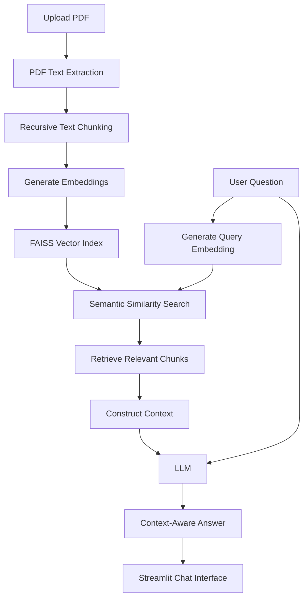

# 📄 RAG PDF Chatbot — AI-Powered Document Question Answering

An AI-powered PDF chatbot built using **Retrieval-Augmented Generation (RAG)** that allows users to upload PDF documents and ask questions in natural language. Instead of relying solely on an LLM's pre-trained knowledge, the application retrieves relevant information from the uploaded document and uses it as context to generate more accurate, document-grounded responses.

The project demonstrates an end-to-end RAG pipeline involving PDF text extraction, text chunking, embeddings, vector search, context retrieval, and LLM-based answer generation.
Live project link :[RAG-CHATBOT](https://rag-pdf-chatbot-joee2vv9rinlgkkyxurwts.streamlit.app/)
---

## ✨ Features

- 📄 **PDF Document Processing** — Extract text from uploaded PDF documents.
- ✂️ **Text Chunking** — Split large documents into smaller, manageable chunks using recursive character-based text splitting.
- 🧠 **Semantic Embeddings** — Convert text chunks into vector representations using HuggingFace embedding models.
- 🔍 **Semantic Search** — Retrieve relevant document chunks based on the meaning of a user's query rather than just keyword matching.
- ⚡ **FAISS Vector Search** — Efficiently search through stored vector embeddings to identify relevant document context.
- 🤖 **Context-Aware AI Responses** — Generate responses using retrieved document content and an LLM.
- 💬 **Interactive Chat Interface** — Ask questions about documents through a Streamlit-based interface.
- 📚 **Document-Based Question Answering** — Query information contained within PDFs without manually searching through pages.

---

## 🧠 What is RAG?

Retrieval-Augmented Generation (RAG) combines information retrieval with generative AI.

Traditional LLMs generate answers using knowledge learned during training. However, they may not know the contents of a specific PDF and can sometimes generate inaccurate information.

RAG addresses this by retrieving relevant information from an external knowledge source before generating a response.

The process follows three main stages:

1. **Retrieval** — Find relevant information from the document based on the user's question.
2. **Augmentation** — Provide the retrieved information to the LLM as contextual input.
3. **Generation** — Generate a response using the retrieved context.

This approach helps make responses more relevant to the uploaded documents and reduces the chances of unsupported answers.

---

## 🏗️ System Architecture



---

## 🔄 How It Works

### 1. PDF Text Extraction

The uploaded PDF is processed to extract its textual content, making the document information accessible to the application.

### 2. Text Chunking

Extracted text is divided into smaller overlapping chunks using LangChain's `RecursiveCharacterTextSplitter`.

Chunking helps the retrieval system identify specific information without processing the entire document as a single block.

Overlapping chunks help preserve context between neighboring sections.

### 3. Embedding Generation

Each text chunk is converted into a numerical vector using a HuggingFace embedding model.

These embeddings capture semantic relationships between text, allowing the system to identify passages that are conceptually relevant to a query.

### 4. Vector Indexing with FAISS

The generated embeddings are stored and indexed using FAISS.

FAISS enables efficient similarity search between the query embedding and document embeddings, helping identify the most relevant text chunks.

### 5. Query Processing

When a user submits a question, the question is converted into an embedding using the same embedding model used for document chunks.

### 6. Semantic Retrieval

FAISS searches for document chunks that are semantically similar to the user's query and retrieves the relevant context.

### 7. Context Augmentation

The retrieved document chunks are combined with the user's question and passed to the LLM as contextual information.

### 8. Response Generation

The LLM uses the retrieved context to generate a relevant, natural-language response, which is displayed through the Streamlit chat interface.

---

## 🛠️ Tech Stack

| Technology | Purpose |
|---|---|
| Python | Core programming language |
| Streamlit | Interactive chatbot interface |
| LangChain | RAG pipeline orchestration and text processing |
| FAISS | Vector indexing and similarity search |
| HuggingFace | Text embedding generation |
| LLM | Context-aware answer generation |
| PDF Processing Library | Extraction of text from PDF documents |

---

## 📁 Project Structure

```text
RAG-PDF-chatbot/
│
├── app.py
├── requirements.txt
├── .env
├── .gitignore
│
└── README.md
```

> The structure above represents the basic project layout. Adjust it to match the actual files and folders in the repository.

---

## ⚙️ Installation & Setup

### Prerequisites

- Python 3.10+
- pip
- Git
- API credentials for the LLM provider used in the project

### 1. Clone the Repository

```bash
git clone https://github.com/kishoricharpe9-ai/RAG-PDF-chatbot.git
```

Navigate to the project directory:

```bash
cd RAG-PDF-chatbot
```

### 2. Create a Virtual Environment

```bash
python -m venv venv
```

Activate the environment.

**Windows:**

```bash
venv\Scripts\activate
```

**Linux / macOS:**

```bash
source venv/bin/activate
```

### 3. Install Dependencies

```bash
pip install -r requirements.txt
```

### 4. Configure Environment Variables

Create a `.env` file in the project root and add the required API credentials and configuration values.

```env
# LLM provider API key
API_KEY=your_api_key_here
```

Replace the placeholder with your actual credentials and use the environment variable name expected by your application.

### 5. Run the Application

```bash
streamlit run app.py
```

Open the local URL displayed in your terminal to access the chatbot.

---

## 💻 How to Use

1. Launch the Streamlit application.
2. Upload the PDF document you want to interact with.
3. Allow the application to process the document and prepare it for retrieval.
4. Enter a question related to the uploaded PDF.
5. The system retrieves relevant text chunks from the document.
6. The LLM uses the retrieved context to generate an answer.
7. Continue asking questions to explore the document's contents.

---

## 📌 Example Use Cases

The chatbot can be used for:

- 📚 Asking questions about academic notes and textbooks.
- 📑 Understanding research papers.
- 🧾 Extracting information from reports and documentation.
- 💼 Exploring company policies and business documents.
- 📖 Summarizing and understanding lengthy PDF content.
- 🔎 Finding specific information without manually searching through an entire document.

---

## ⚖️ Why RAG Instead of Direct LLM Prompting?

| Direct LLM Prompting | Retrieval-Augmented Generation |
|---|---|
| Relies primarily on the model's existing knowledge | Uses external document content |
| May not know information in private documents | Retrieves relevant information from uploaded PDFs |
| Can produce unsupported answers | Provides relevant context to ground the response |
| Limited by the information provided in the prompt | Searches document embeddings for relevant passages |

RAG makes an LLM more useful for document-specific tasks by connecting its language-generation capabilities with information retrieval.

---

## 🚧 Limitations

- Response accuracy depends on the quality of extracted PDF text.
- Poorly structured documents may affect text extraction and retrieval.
- Retrieval quality depends on chunk size, overlap, embedding quality, and query relevance.
- Semantic retrieval may not always retrieve the exact passage needed to answer a question.
- LLM-generated answers can still be inaccurate even when relevant context is provided.
- Scanned PDFs may require OCR if they do not contain an extractable text layer.
- The application depends on the availability and limitations of the configured LLM service.

---

## 🔮 Future Improvements

- Support for multiple PDF documents simultaneously.
- Source references and page-level citations in generated answers.
- Conversational memory for better follow-up questions.
- Hybrid search combining semantic retrieval with keyword search.
- Retrieval reranking for improving context relevance.
- Improved handling of scanned PDFs through OCR.
- Streaming LLM responses.
- Persistent document storage and indexing.
- Retrieval-quality evaluation and hallucination testing.
- Deployment to a cloud platform for public access.

---

## 🎯 Learning Outcomes

Through this project, I explored and implemented important concepts in AI application development:

- Understanding Retrieval-Augmented Generation (RAG).
- Working with text embeddings and semantic representations.
- Implementing vector similarity search using FAISS.
- Processing and chunking unstructured PDF documents.
- Connecting retrieval systems with Large Language Models.
- Designing a context-aware question-answering pipeline.
- Integrating AI workflows into an interactive application.

---

## 👩‍💻 Author

**Kishori Charpe**

⭐ If you find this project interesting, feel free to explore the repository!
